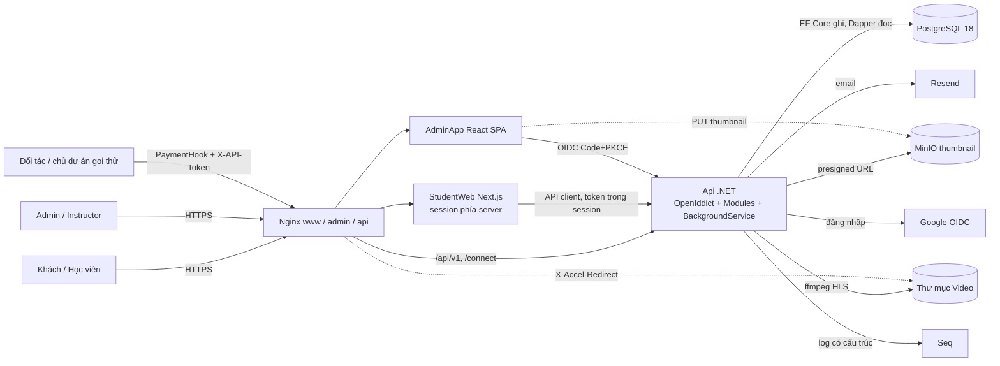
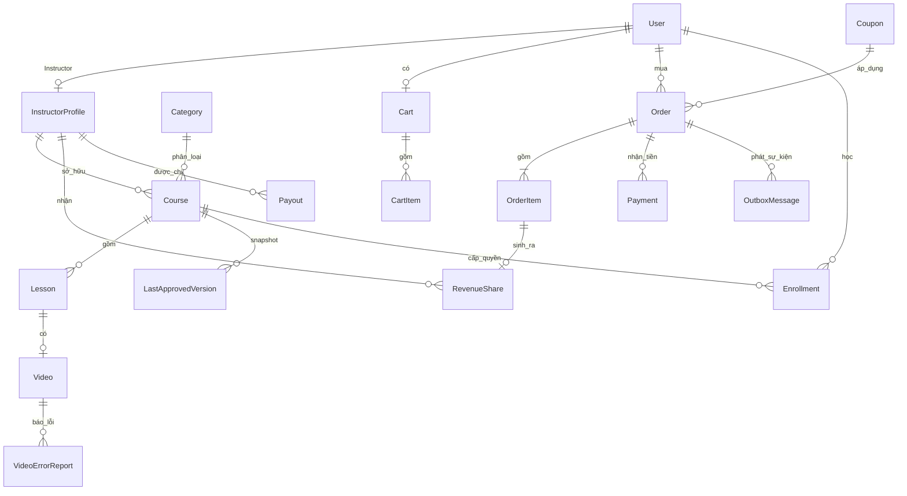

# Kiến trúc — TEDU Market

Nguồn: [prd.md](prd.md), [domain-glossary.md](domain-glossary.md). Team size, deadline, ngân sách là N/A trong PRD, nên kiến trúc **giả định team nhỏ (vài dev), không có DevOps riêng, chạy 1 instance** (NFR-12, NFR-14). Các log mới ở đây có `status: Proposed`, chờ chủ dự án xác nhận.

## 1. Kiến trúc tổng quan

Hệ thống là **một backend .NET modular monolith** (Clean Architecture 4 project: Domain, Application, Infrastructure, Api; CQRS: ghi bằng EF Core + Aggregate, đọc bằng Dapper ra DTO — NFR-12) cộng hai frontend trong một monorepo: `StudentWeb` (Next.js 16, SSR/ISR cho SEO) và `AdminApp` (React SPA). Dữ liệu ở PostgreSQL 18; thumbnail ở MinIO; Video đã mã hóa ở thư mục ngoài wwwroot. Tất cả chạy trên 1 VPS (Docker Compose + Nginx). Module chia theo thư mục nghiệp vụ trong từng layer, gọi nhau qua Mediator/interface của Application; phía ghi không join bảng chéo module. Lý do chọn: [modular monolith](decision-logs/2026-11-11-chon-modular-monolith-clean-architecture-cqrs.md), [1 VPS](decision-logs/2026-11-11-chay-1-vps-docker-compose-nginx.md).

**Luồng mua:** Học viên Checkout → `Order` (New, hạn 15 phút) → `PaymentQr` → chuyển khoản → `PaymentHook` (X-API-Token) chuyển Order sang Paid bằng một UPDATE có điều kiện, **cùng transaction** ghi `OutboxMessage` và `RevenueShare` (PendingShare). Job nền đọc Outbox tạo `Enrollment` và gửi email qua Resend (NFR-02, NFR-05). StudentWeb hỏi trạng thái Order định kỳ (FR-11).

**Luồng nền** (BackgroundService trong process API, [không Hangfire](decision-logs/2026-11-11-job-nen-hosted-service-voi-outbox-thay-hangfire.md)): xử lý Outbox, quét Order Expired/Cancelled (FR-32, FR-52), worker ffmpeg tạo HLS cho Video (FR-35).

**Luồng video:** player xin token phát từ API (kiểm tra Enrollment / PreviewLesson / chủ khóa) → mọi request manifest, segment, key đi qua API kiểm tra token rồi Nginx phục vụ file ([log](decision-logs/2026-11-11-phat-video-hls-aes128-qua-api-va-nginx-xaccel.md)).

## 2. Tech Stack

| Thành phần | Lựa chọn | Lý do (gắn NFR) | Decision log |
|---|---|---|---|
| Kiểu kiến trúc | Modular monolith, Clean Architecture + CQRS (EF Core ghi / Dapper đọc) | NFR-12, NFR-14, NFR-16 | [log](decision-logs/2026-11-11-chon-modular-monolith-clean-architecture-cqrs.md) |
| Backend | .NET 10, ASP.NET Core Minimal API, OpenAPI, `/api/v1` | NFR-17, NFR-13 | — (ràng buộc input) |
| Mediator | Mediator (martinothamar, MIT) | NFR-17 | [log](decision-logs/2026-11-11-dung-mediator-martinothamar-thay-mediatr.md) |
| Validate request | FluentValidation chạy trong pipeline Mediator, lỗi 400 theo từng trường | FR-26 | [log](decision-logs/2026-11-12-dung-fluentvalidation-cho-validate-request.md) |
| CSDL | PostgreSQL 18 (full-text search + `unaccent`) | NFR-17, NFR-01, FR-44 | [PG18](decision-logs/2026-11-11-chon-postgresql-18.md), [FTS](decision-logs/2026-11-11-tim-kiem-fulltext-postgresql.md) |
| Authn | OpenIddict + ASP.NET Core Identity trong API; Google external login | NFR-06, NFR-14 | [log](decision-logs/2026-11-11-openiddict-chay-chung-trong-api-google-external.md), [SSO](decision-logs/2026-11-11-student-dang-nhap-google-sso.md) |
| StudentWeb | Next.js 16 App Router, SSR/ISR, session phía server | NFR-11, NFR-03, NFR-06 | [log](decision-logs/2026-11-11-chon-nextjs-16.md) |
| AdminApp | React (Vite) SPA, `react-oidc-context` | NFR-06, NFR-17 | [log](decision-logs/2026-11-11-monorepo-pnpm-turborepo-api-client-openapi-ts.md) |
| API client | Monorepo pnpm + Turborepo, `@hey-api/openapi-ts` | NFR-13 | cùng log trên |
| Job nền | BackgroundService + bảng `OutboxMessage` | NFR-02, NFR-05 | [log](decision-logs/2026-11-11-job-nen-hosted-service-voi-outbox-thay-hangfire.md) |
| Chống Paid trùng | UPDATE có điều kiện + unique index | NFR-04 | [log](decision-logs/2026-11-11-chong-paid-hai-lan-bang-cap-nhat-co-dieu-kien.md) |
| Video | ffmpeg → HLS AES-128, thư mục riêng, API cấp token, Nginx X-Accel-Redirect | NFR-21, NFR-20 | [log](decision-logs/2026-11-11-phat-video-hls-aes128-qua-api-va-nginx-xaccel.md), [static](decision-logs/2026-11-11-video-static-folder-ma-hoa-ffmpeg.md), [phân quyền](decision-logs/2026-11-11-video-static-folder-phai-phan-quyen.md) |
| Bản duyệt gần nhất | `LastApprovedVersion` snapshot JSONB | NFR-01 | [log](decision-logs/2026-11-11-luu-ban-duyet-gan-nhat-bang-snapshot-jsonb.md) |
| Thumbnail | MinIO (S3), presigned URL | NFR-03, FR-23 | [log](decision-logs/2026-11-11-minio-luu-thumbnail-presigned-url.md) |
| Cache / rate limit | Output Cache + RateLimiter trong bộ nhớ, không Redis | NFR-01, NFR-10, NFR-12 | [log](decision-logs/2026-11-11-cache-trong-bo-nho-khong-dung-redis.md) |
| Email | Resend | NFR-18 | [log](decision-logs/2026-11-11-gui-email-bang-resend.md) |
| Bảo vệ hook | Header `X-API-Token` | NFR-07, NFR-22 | [log](decision-logs/2026-11-11-bao-ve-hook-bang-x-api-token.md) |
| Log | Serilog + Seq, CorrelationId (header `X-Correlation-Id`, có trong log, ProblemDetails và response); `/health/live`, `/health/ready` (PostgreSQL, MinIO) | NFR-15, NFR-14 | — |
| Test | xUnit, integration test với PostgreSQL thật (Testcontainers) | NFR-16, NFR-04 | — |
| Hosting | 1 VPS, Docker Compose, Nginx, CI chạy test trước deploy | NFR-14, NFR-19, NFR-16 | [log](decision-logs/2026-11-11-chay-1-vps-docker-compose-nginx.md) |

## 3. Module

Tên module theo cột Code của glossary; `Identity` và `Notification` là **tên kỹ thuật nội bộ**.

### Module: Course
- Trách nhiệm: `Course`, `Lesson`, `Category`, `PreviewLesson`, vòng đời `Draft` → `PendingApproval` → `Published`/`Rejected`, `CourseApproval`, `LastApprovedVersion`, danh sách + tìm kiếm + chi tiết công khai.
- FR: FR-01, 02, 17, 19–23, 36, 44, 45, 49, 51. Phụ thuộc: `Instructor`, `Video`.
- Thuật ngữ: `RejectionReason`, `Resubmit`. Truy vấn công khai đọc `LastApprovedVersion` (chỉ khi `Published`); khóa sửa khi `Published` → `PendingApproval` (Admin sửa thì không cần duyệt).

### Module: Instructor
- Trách nhiệm: `InstructorApproval` (gán role + tạo `InstructorProfile`), sửa hồ sơ của mình, `InstructorShareRate` đặt/xóa.
- FR: FR-18, 39, 40, 43. Phụ thuộc: `Identity`, `Revenue` (đọc `DefaultShareRate`).

### Module: Video
- Trách nhiệm: nhận upload mp4 ≤ 1 GB, worker ffmpeg → HLS AES-128, `VideoProcessingStatus`, cấp token phát và phục vụ file qua endpoint kiểm tra quyền, `VideoErrorReport`.
- FR: FR-16, 34, 35, 46, 50; NFR-20, 21. Phụ thuộc: `Enrollment` (kiểm tra quyền), `Course`.

### Module: Cart
- Trách nhiệm: `Cart` mỗi `Student` 1 giỏ; thêm/xóa khóa; chặn khóa đã có `Enrollment`.
- FR: FR-06, 29, 30. Phụ thuộc: `Coupon`, `Enrollment` (đọc), `Course` (đọc giá).

### Module: Coupon
- Trách nhiệm: Admin tạo/quản lý `Coupon`; tính giá cuối theo %, thời hạn, giới hạn khóa.
- FR: FR-07, 31. Phụ thuộc: `Course` (đọc).

### Module: Order
- Trách nhiệm: `Checkout` (idempotency key) → `Order` (+ dòng đơn, **tên kỹ thuật nội bộ**: `OrderItem`, giữ giá cuối và tỷ lệ chia sao chép khi `Paid`), máy trạng thái `New`/`OnHold`/`Paid`/`Expired`/`Cancelled`, `OrderResolution`, job hết hạn/tự hủy, lịch sử đơn.
- FR: FR-08, 09, 24, 32, 33, 37, 52. Phụ thuộc: `Cart`, `Coupon`, `Enrollment`, `Revenue`. Checkout từ chối khóa đã `Enrollment` hoặc đang nằm trong đơn `New`/`OnHold` còn hiệu lực.

### Module: Payment
- Trách nhiệm: `PaymentQr` (VietQR, tài khoản nhận từ `appsettings.json`), `TransferContent` duy nhất, `PaymentHook`, `Payment` (ghi mỗi lần hook báo tiền), `AmountDiscrepancy`.
- FR: FR-10–13, 53; NFR-04, 07, 10. Phụ thuộc: `Order`.
- Hook nhận `transferContent`, `amount` (+ `transactionRef` nếu có). Đủ tiền, đơn `New` còn hạn hoặc `OnHold` → `Paid`, 200; đã `Paid` → 200 không đổi gì; `Expired`/`Cancelled` hoặc `New` quá `ExpiresAt` → `OnHold`, 200 (FR-53); thừa/thiếu → `OnHold`, 400.
- `errorCode`: `INVALID_TOKEN`, `ORDER_NOT_FOUND`, `AMOUNT_MISMATCH`, `INVALID_REQUEST` (400); `INTERNAL_ERROR` (500).

### Module: Enrollment
- Trách nhiệm: tạo `Enrollment` từ Outbox (idempotent, unique Student+Course), thu hồi khi `Cancelled`, `MyCourses`, email hoàn thành đơn.
- FR: FR-14, 15, 33 (thu hồi), 16 (quyết định quyền học). Phụ thuộc: `Order`, `Notification`.

### Module: Revenue
- Trách nhiệm: `RevenueShare` (`PendingShare` → duyệt), `Balance`, `Payout` không vượt `Balance`, dashboard `Revenue`, `DefaultShareRate` từ cấu hình.
- FR: FR-25, 38, 39, 47, 48. Phụ thuộc: `Instructor` (đọc `InstructorShareRate`), `Order`.

### Module: Identity
- Trách nhiệm: OpenIddict + ASP.NET Core Identity, vai trò `Student`/`Instructor`/`Admin` (`Guest` = chưa đăng nhập), Google login, seeding `Admin`, đổi mật khẩu, thu hồi token.
- FR: FR-03, 04, 05, 41, 42. Phụ thuộc: `Notification` (email chào mừng FR-27).

### Module: Notification
- Trách nhiệm: gửi email qua Resend từ `OutboxMessage`, retry; tách khỏi Enrollment để lỗi email không chặn quyền học.
- FR: FR-14 (email), FR-27; NFR-18. Phụ thuộc: không.

## 4. Bảo mật

**Authn:** Code + PKCE (NFR-06). AdminApp giữ token trong bộ nhớ SPA; StudentWeb là OIDC client phía server, token trong cookie session httpOnly mã hóa, không dùng localStorage. Đăng xuất thu hồi token (FR-04). `PaymentHook` chỉ dùng `X-API-Token` (không qua OIDC), so sánh thời gian cố định, sai/thiếu → 400 `INVALID_TOKEN`, không đổi dữ liệu (NFR-07).

**Authz (FR-05, NFR-08):** policy theo role ở endpoint + kiểm tra sở hữu trong Handler (chống IDOR). Ma trận:

| Hành động | Guest | Student | Instructor | Admin |
|---|---|---|---|---|
| Xem danh sách/chi tiết, `PreviewLesson` | ✔ | ✔ | ✔ | ✔ |
| Cart, Checkout, `MyCourses`, lịch sử đơn | — | của mình | của mình (cũng là Student) | — |
| Xem Video (không xem thử) | — | có `Enrollment` | khóa của mình | ✔ |
| Gửi `VideoErrorReport` | — | có `Enrollment` | — | xem/nhận |
| Tạo/sửa Course, Lesson, upload Video, đánh dấu `PreviewLesson` | — | — | khóa của mình | mọi khóa |
| Gửi duyệt, `Resubmit`, sửa `InstructorProfile` | — | — | của mình | — |
| `CourseApproval`, Category, Coupon, Instructor, `OrderResolution`, danh sách Order, tỷ lệ chia, duyệt `PendingShare`, `Payout` | — | — | — | ✔ |
| Dashboard `Revenue`, `Balance` | — | — | của mình | tất cả |

**Secret (NFR-22):** mật khẩu Admin seed sinh ngẫu nhiên, ghi `secret.json` (trong `.gitignore`), lưu băm bằng Identity (PBKDF2). `X-API-Token`, Google client secret, Resend key, khóa MinIO, khóa ký token phát video đọc từ biến môi trường/file bí mật ngoài source control. Tài khoản nhận QR không phải secret nên để `appsettings.json` ([log](decision-logs/2026-11-11-qr-vietqr-tai-khoan-trong-appsettings.md)).

**Threat mặc định:**
- Injection: Dapper chỉ dùng tham số; không nối chuỗi SQL. Tìm kiếm dùng `websearch_to_tsquery` với tham số.
- IDOR/mass assignment: Handler kiểm tra sở hữu (Order, Cart, Course, Lesson); DTO nhận vào khai báo tường minh.
- Upload (FR-35): kiểm tra đuôi, magic bytes mp4 và 1 GB ở Nginx + Kestrel; tên file sinh bằng GUID; ffmpeg gọi bằng danh sách tham số (không qua shell), có timeout. Thumbnail: presigned PUT giới hạn kiểu/dung lượng.
- XSS: React escape mặc định; mô tả khóa nếu cho HTML phải sanitize phía server. CSRF: API dùng Bearer; cookie session StudentWeb `SameSite=Lax`.
- Rate limit (NFR-10): nhóm checkout/payment 10 request/phút/người dùng → 429; hook thêm giới hạn theo IP để chống dò token.
- NFR-09: HTTPS ở Nginx, CORS chỉ origin AdminApp và StudentWeb (cấu hình `Cors:AllowedOrigins`, danh sách ngăn bởi dấu phẩy), security headers (`SecurityHeadersMiddleware`). Output Cache policy `Catalog` 60 s, tag `catalog` để xóa cache; rate limit policy `Checkout` dùng `ApiPolicies` (`Api/Common`), vượt giới hạn trả 429 `errorCode: RATE_LIMITED`. Lỗi trả ProblemDetails, không lộ stack trace (FR-26).
- Log không ghi token, mật khẩu; `Payout`, `OrderResolution` lưu người thực hiện.

## 5. Performance

| Mục tiêu | Cách đạt |
|---|---|
| NFR-01 list/chi tiết p95 ≤ 300 ms @100 rps | Dapper một câu SQL (không N+1), index `(Status, CategoryId)`, giá, `PublishedAt`; cột `search vector` (tên kỹ thuật nội bộ, GIN) trên bản đã duyệt; Output Cache 30–60 s, xóa cache khi duyệt khóa |
| NFR-03 LCP ≤ 2,5 s, NFR-11 | SSR/ISR có revalidate, `next/image`, thumbnail cache qua Nginx, metadata riêng mỗi khóa |
| NFR-02 Paid → Enrollment ≤ 30 s p95 | Outbox thăm dò mỗi ~2 s, `FOR UPDATE SKIP LOCKED`, xử lý theo lô |
| NFR-04/05 | UPDATE có điều kiện + unique index; Paid và Outbox cùng transaction |
| NFR-20 video ≤ 3 s p95 | HLS segment ngắn (2–4 s), token ký kiểm tra không chạm DB, Nginx phục vụ file |
| NFR-12 | 1 instance; connection pool PostgreSQL; ffmpeg giới hạn số tiến trình song song để không chiếm CPU của API |
| Job hết hạn (FR-32/52) | Quét mỗi 30 s theo index `(Status, ExpiresAt)` |

## 6. Data model tổng quan

Tên kỹ thuật nội bộ (không có trong glossary): `User` (tài khoản Identity; vai trò là role), `CartItem`, `OrderItem`, `OutboxMessage`, khóa idempotency của `Checkout`, cột search vector. `Balance` không có bảng: tính từ `RevenueShare` đã duyệt trừ `Payout`. `InstructorShareRate` nằm ở `InstructorProfile`; `DefaultShareRate` ở cấu hình. Mỗi `Payment` ghi một lần hook (kể cả lệch tiền).

## 7. Rủi ro kỹ thuật

**Trade-off / scale:**
- Cache và rate limit trong bộ nhớ: mất khi restart, scale ngang phải thêm Redis ([log](decision-logs/2026-11-11-cache-trong-bo-nho-khong-dung-redis.md)).
- Job ffmpeg và Outbox chạy chung process API: video nặng tranh CPU với request; tách worker khi cần.
- OpenIddict chung process: API sập là mất đăng nhập.
- Token phát video chia sẻ được trong thời hạn token; AES-128 không phải DRM.
- Full-text search cấu hình `simple` + `unaccent`: không có stemming tiếng Việt, xếp hạng chỉ ở mức cơ bản.
- `LastApprovedVersion`: file Video cũ giữ đến lần duyệt sau, tốn dung lượng.

**FR/NFR chưa đáp ứng hoặc đáp ứng không chắc chắn:**
- **NFR-14**: 1 VPS không HA; deploy gây ngắt ngắn; 99% đạt được nếu hạ tầng không hỏng.
- **NFR-19**: RTO 4 giờ dựa vào restore thủ công (pg_dump hằng ngày, đồng bộ thư mục Video và MinIO ra ngoài VPS); chưa thiết kế chi tiết, cần diễn tập và dung lượng video có thể lớn. Thuộc tài liệu deploy.
- **NFR-12 + NFR-20**: 500 người đồng thời xem video trên 1 VPS phụ thuộc băng thông máy chủ; chưa có số đo, kiến trúc không cam kết; hướng sau là CDN.
- **NFR-18**: hạn mức gói free của Resend (cần kiểm tra) có thể không đủ cho 10.000 tài khoản; email còn lại nằm trong Outbox và gửi trễ.
- **NFR-23**: upload 1 GB qua một request, không resume; mạng yếu có thể thất bại; kiến trúc không đảm bảo kết quả thử người dùng. Hướng: upload resumable (ví dụ tus).
- **FR-33 (PRD chưa nói)**: hủy đơn đã `Paid` thu hồi `Enrollment` nhưng `RevenueShare` đã sinh thì chưa có quy tắc (hủy khoản `PendingShare`? `Balance` có âm?). Chưa xử lý, cần chủ dự án quyết.
- **FR-12 (PRD chưa nói)**: payload hook, mã giao dịch ngân hàng và cộng dồn tiền chuyển bù nhiều lần chưa định nghĩa; hiện mỗi lần gọi xét riêng và lệch tiền chuyển `OnHold` cho Admin; cần chốt khi tích hợp đối tác thật.
- **NFR-11, NFR-16**: ngưỡng Lighthouse ≥ 90 và coverage 70% chỉ kiểm chứng được bằng đo/CI, kiến trúc tạo điều kiện chứ không bảo đảm.
