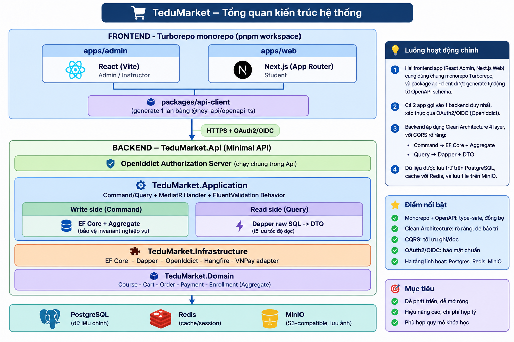

**TEDU**

tedu.com.vn

# Bài 0.1 — Tổng quan dự án & bản đồ kiến trúc

*Xây dựng ứng dụng bán khóa học trực tuyến với ASP.NET Core 10, Clean Architecture, CQRS, OpenIddict & React/Next.js*

## Thông tin bài giảng

| **Khóa học** | Xây dựng ứng dụng bán khóa học trực tuyến với ASP.NET Core 10 — Clean Architecture, CQRS, OpenIddict & React/Next.js |
|---|---|
| **Module** | Module 0 — Kiến trúc nền & Khởi tạo dự án |
| **Bài** | 0.1 — Tổng quan dự án & bản đồ kiến trúc |
| **Loại / Thời lượng** | Lý thuyết · 30 phút |
| **Dự án xuyên suốt** | TEDU Market — nền tảng bán khóa học trực tuyến |
| **Version** | v1.0 — 15/09/2026 |

| **Mục tiêu bài học** | Giải thích được vì sao TEDU Market dùng Clean Architecture + CQRS ngay từ bài đầu tiên, không đợi "refactor sau".<br>Vẽ lại được sơ đồ kiến trúc tổng thể của hệ thống: backend 4 layer, OpenIddict, 2 frontend app, monorepo.<br>Liệt kê được 5 bounded context của TEDU Market (Catalog, Ordering, Payment, Enrollment, Identity) và mô tả vai trò từng context trong 1 câu.<br>Nắm được lộ trình 10 module của khóa học, biết mỗi module sẽ cho ra deliverable gì. |
|---|---|
| **Thời lượng từng phần** | TEDU Market là gì, khác gì Mini LMS: 8 phút<br>Sơ đồ kiến trúc tổng thể: 10 phút<br>Vì sao Clean Architecture + CQRS ngay từ đầu: 8 phút<br>Lộ trình 10 module: 4 phút |
| **Prerequisites** | Đã biết C# + ASP.NET Core cơ bản (Controller, EF Core CRUD đơn giản) — tương đương học viên đã hoàn thành khóa "Xây dựng website học trực tuyến với ASP.NET Core". Bài này không có code, chỉ cần nắm khái niệm. |
| **Tools / Software** | Không cần cài đặt gì cho bài này — bài lý thuyết thuần. Việc cài .NET 10 SDK, Docker, Node.js sẽ chuẩn bị ở bài 0.2. |

# Nội dung chính

## 1. TEDU Market là gì — và khác gì "Mini LMS"? (8 phút)

Nếu bạn đã học khóa "Xây dựng website học trực tuyến với ASP.NET Core", đừng nghĩ khóa này là bản nâng cấp của cùng một bài toán. Mini LMS ở khóa nền tảng giải quyết bài toán quản lý nội dung: tạo khóa học, thêm bài giảng, hiển thị danh sách. TEDU Market giải quyết một bài toán khác hẳn: toàn bộ hành trình thương mại — người dùng duyệt khóa học, thêm vào giỏ hàng, thanh toán, và chỉ sau khi thanh toán thành công mới có quyền truy cập nội dung.

Sự khác biệt này không phải để làm khó — nó là lý do khiến kiến trúc CQRS, Outbox Pattern, Idempotency ở khóa này có ý nghĩa thật, thay vì chỉ là kỹ thuật minh họa suông. Khi có tiền thật đi qua hệ thống (dù là VNPay sandbox), bài toán "đảm bảo Order chuyển Paid và Enrollment được tạo đúng 1 lần dù webhook gọi lại nhiều lần" mới trở thành vấn đề cần giải, chứ không phải bài tập giả định.

TEDU Market được chia thành 5 bounded context — mỗi context là một mảng nghiệp vụ độc lập, có Aggregate và invariant riêng:

| **Bounded Context** | **Vai trò** |
|---|---|
| **Catalog** | Course, Category, Lesson, Instructor — nội dung khóa học để bán |
| **Ordering** | Cart, Order, OrderItem, Coupon — giỏ hàng và đơn hàng |
| **Payment** | Payment, tích hợp VNPay sandbox — xử lý thanh toán |
| **Enrollment** | Quyền truy cập khóa học sau khi thanh toán thành công |
| **Identity** | User, Role — quản lý qua ASP.NET Core Identity + OpenIddict |

> **📘 Ghi chú giảng viên:** *Học viên cũ hay hỏi "sao không dùng lại code Mini LMS rồi thêm giỏ hàng vào là xong?" — Tôi thường trả lời bằng câu hỏi ngược: nếu Course và Order dùng chung 1 Aggregate, khi Order bị hủy thì Course có bị ảnh hưởng theo không? Câu trả lời phải là không — đó chính là lý do Ordering phải tách khỏi Catalog thành bounded context riêng ngay từ đầu, không phải tách sau.*

## 2. Sơ đồ kiến trúc hệ thống tổng thể (10 phút)

Đây là sơ đồ tham khảo xuyên suốt khóa học — mọi bài từ Module 0 đến Module 9 đều là một mảnh ghép cụ thể của sơ đồ này. Hãy lưu lại, vì các bài sau sẽ liên tục quay lại tham chiếu đúng vị trí layer đang làm việc.

```
+------------------------------------------------------------+
|  FRONTEND - Turborepo monorepo (pnpm workspace)             |
|   +------------------+        +------------------+          |
|   | apps/admin       |        | apps/web         |          |
|   | React (Vite)     |        | Next.js (App     |          |
|   | Admin/Instructor |        | Router) - Student|          |
|   +--------+---------+        +--------+---------+          |
|            +------------+------------+                      |
|                packages/api-client                          |
|         (generate 1 lan bang @hey-api/openapi-ts)            |
+------------------------+-------------------------------------+
                          | HTTPS + OAuth2/OIDC
+-------------------------v-------------------------------------+
|  BACKEND - TeduMarket.Api (Minimal API)                       |
|  + OpenIddict Authorization Server (chay chung trong Api)     |
+-----------------------------------------------------------------+
|  TeduMarket.Application                                        |
|  Command/Query + MediatR Handler + FluentValidation Behavior   |
+------------------------------+----------------------------------+
|  Write side (Command)        |  Read side (Query)                |
|  EF Core + Aggregate         |  Dapper raw SQL -> DTO thang      |
+------------------------------+----------------------------------+
|  TeduMarket.Infrastructure                                      |
|  EF Core - Dapper - OpenIddict - Hangfire - VNPay adapter        |
+-----------------------------------------------------------------+
|  TeduMarket.Domain                                              |
|  Course - Cart - Order - Payment - Enrollment (Aggregate)        |
+------------------------+-----------------------------------------+
                          |
        PostgreSQL   -   Redis   -   MinIO (S3-compatible)
```



Đọc sơ đồ từ trên xuống:

- Hai frontend app (React Admin cho quản trị, Next.js cho học viên) sống trong 1 monorepo Turborepo, dùng chung 1 package api-client được generate tự động từ OpenAPI schema của backend — đổi API ở backend, generate lại 1 lệnh, cả 2 app nhận type mới cùng lúc.
- Cả 2 frontend gọi vào đúng 1 backend API duy nhất, xác thực qua OAuth2/OIDC do OpenIddict cấp — OpenIddict không phải service tách riêng mà chạy chung trong TeduMarket.Api, để giảm độ phức tạp vận hành phù hợp quy mô khóa học.
- Backend là Clean Architecture 4 layer: Api → Application → Infrastructure → Domain, chiều phụ thuộc luôn hướng vào trong. Application là nơi CQRS thể hiện rõ nhất: Command đi qua EF Core + Aggregate để bảo vệ invariant nghiệp vụ, Query đi thẳng qua Dapper để tối ưu tốc độ đọc — không đi qua Entity của Command side.
- Hạ tầng bên dưới gồm PostgreSQL (dữ liệu chính), Redis (cache/session), MinIO (lưu ảnh Course, tương thích S3).

> **📘 Ghi chú giảng viên:** *Khi quay video, tôi thường vẽ lại sơ đồ này trên Excalidraw hoặc bảng trắng theo từng lớp — vẽ đến đâu giải thích đến đó thay vì show nguyên sơ đồ hoàn chỉnh ngay từ đầu, học viên sẽ dễ theo hơn. Tài liệu text ở đây là bản tham khảo tĩnh để học viên tra cứu lại sau, không phải kịch bản trình bày.*

## 3. Vì sao Clean Architecture + CQRS ngay từ bài đầu tiên? (8 phút)

Cách dạy truyền thống thường đi theo trình tự: viết Controller gọi thẳng DbContext cho nhanh có kết quả, rồi đến cuối khóa mới "refactor sang kiến trúc đúng" như một bài học riêng. Cách này có vẻ dễ tiếp cận hơn ở tuần đầu, nhưng tạo ra ảo giác sai: học viên quen tay với cách viết code gắn chặt vào hạ tầng, và refactor cuối khóa trở thành một bài tập chép lại kiến trúc mẫu, không phải một kỹ năng thấm vào phản xạ viết code hàng ngày.

Khóa này chọn ngược lại: dựng khung xương Clean Architecture + CQRS chạy được end-to-end với 1 use case đơn giản (Category) ngay từ Module 0, rồi lặp lại đúng pattern đó ở mọi Aggregate tiếp theo (Course ở Module 1, Order ở Module 2...). Cái giá phải trả là bài đầu tiên phức tạp hơn một Controller gọi DbContext thông thường — 4 project thay vì 1, phải hiểu Dependency Inversion trước khi viết dòng code nghiệp vụ đầu tiên. Đổi lại, từ Module 1 trở đi, mỗi Aggregate mới chỉ là lặp lại một pattern đã quen, không phải học lại từ đầu.

Về CQRS cụ thể: nhiều tài liệu dạy CQRS theo kiểu chỉ tách tên class thành Command và Query, nhưng bên dưới cả hai vẫn thao tác trên cùng 1 EF Core entity — đó là CQRS hình thức, không giải quyết vấn đề gì thật. Ở khóa này, Command side dùng EF Core + Aggregate để bảo vệ tính toàn vẹn nghiệp vụ (ví dụ: Course phải có ít nhất 1 Lesson mới được publish), còn Query side dùng Dapper raw SQL chiếu thẳng ra DTO, không tái sử dụng Entity của Command side — tối ưu riêng cho tốc độ đọc. Đây là CQRS có lý do tồn tại thật, sẽ thấy rõ nhất khi so sánh hiệu năng 2 cách viết cùng 1 query ở bài 0.8 và 1.6.

> **📘 Ghi chú giảng viên:** *Câu hỏi hay gặp nhất: "Dự án nhỏ của em có cần làm phức tạp thế này không?". Tôi trả lời thẳng: không phải lúc nào cũng cần. Đây là trade-off, không phải luật bất biến — nếu dự án chỉ có vài entity, ít thay đổi, layered đơn giản có khi lại là lựa chọn đúng hơn. TEDU Market chọn kiến trúc này vì có đủ độ phức tạp nghiệp vụ thật (thanh toán, tồn tại race condition, cần tách read/write) để kiến trúc này chứng minh giá trị, không phải vì "kiến trúc phức tạp luôn tốt hơn".*

## 4. Lộ trình 10 module — bức tranh toàn cảnh (4 phút)

Khóa học có 72 bài chia thành 10 module, đi theo thứ tự: xây khung xương → xây nghiệp vụ Catalog → xây nghiệp vụ bán hàng (Order/Payment) → bảo mật thật với OpenIddict → hoàn thiện API → nối sang 2 frontend → kiểm thử → đưa lên production.

| **Module** | **Nội dung** | **Số bài** |
|---|---|---|
| Module 0 | Kiến trúc nền & khởi tạo dự án | 10 bài |
| Module 1 | Catalog: Course, Lesson, Instructor | 10 bài |
| Module 2 | Order & Payment | 9 bài |
| Module 3 | OpenIddict — Authorization Server | 9 bài |
| Module 4 | API hoàn thiện & OpenAPI-first | 5 bài |
| Module 5 | Monorepo & API Client Codegen | 4 bài |
| Module 6 | React Admin | 6 bài |
| Module 7 | Next.js Student Site | 7 bài |
| Module 8 | Testing | 4 bài |
| Module 9 | Production | 8 bài |

Từ Module 0 đến Module 4 là backend thuần. Module 5 là cầu nối sang frontend (generate API client type-safe). Module 6–7 xây 2 app frontend dùng lại toàn bộ những gì backend đã có. Module 8–9 kiểm chứng và đưa hệ thống lên production thật.

> **📘 Ghi chú giảng viên:** *Tôi thường nhắc lại bức tranh này ở đầu mỗi module mới, chỉ 1-2 câu: "chúng ta đang ở module mấy, vừa xong việc gì, sắp làm việc gì" — học viên online rất dễ mất track vị trí của mình trong khóa dài 72 bài nếu không được nhắc lại thường xuyên.*

# Bài tập / Thực hành

> **✏️ Thực hành:** Không nhìn lại tài liệu, hãy tự vẽ ra giấy (hoặc Excalidraw) sơ đồ kiến trúc TEDU Market theo trí nhớ của bạn: 4 layer backend, vị trí OpenIddict, 2 frontend app, và cách chúng kết nối với nhau. Sau đó liệt kê 5 bounded context và viết đúng 1 câu mô tả vai trò mỗi context — không mở lại mục 1. So sánh kết quả với sơ đồ và bảng ở bài này, ghi chú lại phần nào bạn nhớ sai hoặc thiếu.

Gợi ý (hint): nếu bí ở bước vẽ layer backend, nhớ quy tắc chiều phụ thuộc — layer trong cùng (Domain) không phụ thuộc gì cả, mỗi layer bên ngoài chỉ phụ thuộc vào layer ngay bên trong nó.

Đáp án tham khảo: xem lại sơ đồ ở mục 2 và bảng 5 bounded context ở mục 1 của bài này.

# Tổng kết

> **✅ Tóm tắt:** TEDU Market bán khóa học trực tuyến, không chỉ quản lý nội dung — đây là lý do CQRS, Outbox, Idempotency có ý nghĩa thật trong khóa này. Hệ thống gồm 5 bounded context (Catalog, Ordering, Payment, Enrollment, Identity), backend Clean Architecture 4 layer với OpenIddict chạy chung trong Api project, và 2 frontend app (React Admin, Next.js Student) dùng chung 1 api-client được generate tự động trong monorepo Turborepo. Kiến trúc này được dựng ngay từ Module 0 thay vì "refactor sau" — đổi lấy việc mọi Aggregate từ Module 1 trở đi chỉ là lặp lại một pattern đã quen.

Bước tiếp theo: Bài 0.2 — Khởi tạo Clean Architecture Solution, nơi bạn sẽ tạo 4 project .NET đầu tiên và thiết lập đúng chiều phụ thuộc giữa chúng.
